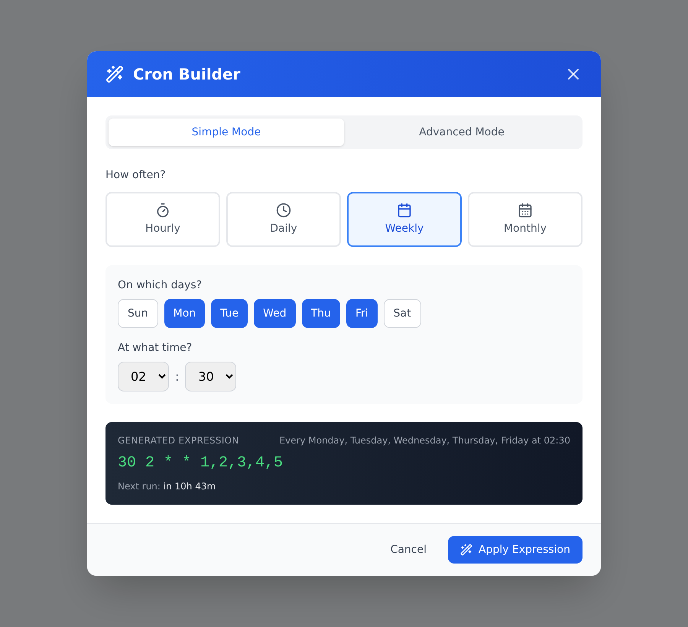
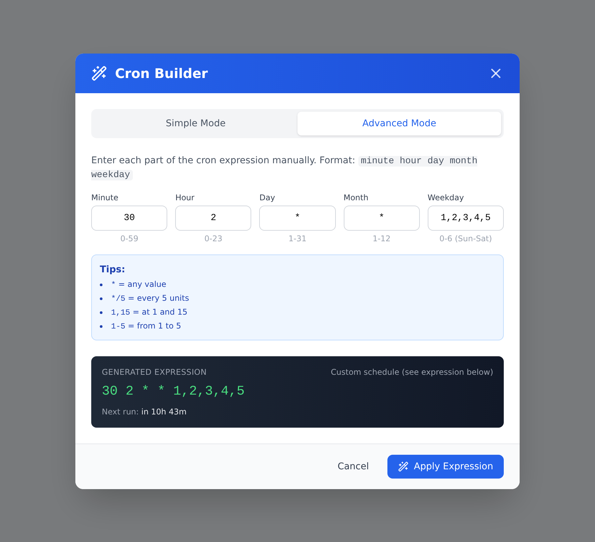

# Cron Builder

A visual **cron expression builder for React**. Users choose *hourly / daily / weekly / monthly* and a time, and the component outputs a standard 5-field Linux crontab expression such as `30 2 * * 1,2,3,4,5`. Users who already know cron can switch to Advanced Mode and edit each field directly.

**[▶ Live demo](https://smartinventure.github.io/cron-builder/?open)**



<details>
<summary>Advanced Mode</summary>



</details>

## Features

- **Simple Mode** – click a schedule together without knowing cron syntax:
  - **Hourly** – every 1, 2, 3, 4, 6, 8 or 12 hours at minute :00 / :15 / :30 / :45
  - **Daily** – at any hour:minute
  - **Weekly** – pick one or more weekdays plus a time
  - **Monthly** – day 1–28 (so it runs in every month), optionally limited to selected months
- **Advanced Mode** – edit minute / hour / day / month / weekday directly, with inline hints for `*`, `*/5`, `1,15` and `1-5`
- **Live preview** – the generated expression, a plain-English description ("Every Monday, Friday at 02:30") and the time until the next run ("in 10h 43m")
- **Round-trips existing expressions** – pass in an expression and the builder opens in the matching mode with the fields filled in. Anything Simple Mode can't represent opens in Advanced Mode.
- **`calculateNextRun()` helper** – also exported on its own, so you can show "next run" in your own tables and dashboards
- Written in TypeScript, ships with type declarations, and styled with Tailwind CSS. A precompiled stylesheet is included for apps that don't use Tailwind.

The expressions are standard cron syntax, so they work in Linux `crontab`, systemd-cron, borgmatic, Kubernetes `CronJob`, GitHub Actions `schedule:`, node-cron and most other schedulers.

## Installation

The package is not on npm yet. Install it straight from GitHub; the `prepare` script builds `dist/` during install:

```bash
npm install github:smartinventure/cron-builder lucide-react
```

Peer dependencies: `react` ≥ 17, `react-dom` ≥ 17 and `lucide-react` (for the icons).

You can also copy [`src/CronBuilder.tsx`](src/CronBuilder.tsx) and [`src/cronNextRun.ts`](src/cronNextRun.ts) into your project. They are the whole component.

## Usage

```tsx
import { useState } from 'react';
import { CronBuilder } from '@smartinventure/cron-builder';

export function ScheduleField() {
    const [cron, setCron] = useState('0 2 * * *');
    const [open, setOpen] = useState(false);

    return (
        <>
            <input value={cron} onChange={(e) => setCron(e.target.value)} />
            <button onClick={() => setOpen(true)}>Build…</button>

            <CronBuilder
                isOpen={open}
                onClose={() => setOpen(false)}
                onApply={setCron}
                initialExpression={cron}
            />
        </>
    );
}
```

### Styling

The component is styled with Tailwind utility classes. Pick **one** of these two setups:

**A) Your app uses Tailwind CSS (v3).** Add the package source to `content` so Tailwind generates the classes it uses:

```js
// tailwind.config.js
export default {
    content: [
        './src/**/*.{ts,tsx}',
        './node_modules/@smartinventure/cron-builder/src/**/*.{ts,tsx}',
    ],
};
```

**B) Your app does not use Tailwind.** Import the precompiled stylesheet once:

```ts
import '@smartinventure/cron-builder/style.css';
```

This stylesheet leaves out Tailwind's global reset ("preflight"). It includes only a small reset scoped to the builder, so the rest of your page is not affected.

## API

### `<CronBuilder />`

The builder is a modal dialog (a fixed full-screen overlay, `z-index: 60`).

| Prop                | Type                           | Default       | Description                                                                 |
| ------------------- | ------------------------------ | ------------- | --------------------------------------------------------------------------- |
| `isOpen`            | `boolean`                      | –             | Shows or hides the modal.                                                   |
| `onClose`           | `() => void`                   | –             | Called on **Cancel**, on the close icon, and after **Apply**.               |
| `onApply`           | `(cronExpression: string) => void` | –         | Called with the generated expression when the user clicks **Apply Expression**. |
| `initialExpression` | `string`                       | `'0 2 * * *'` | Expression used to pre-fill the builder. Re-parsed whenever it changes.     |

### `calculateNextRun(expression: string): string`

Returns a short, human-readable countdown to the next time a 5-field cron expression fires, using the browser's local time:

```ts
import { calculateNextRun } from '@smartinventure/cron-builder';

calculateNextRun('*/15 * * * *'); // "in 12 min"
calculateNextRun('30 14 * * *');  // "in 4h 30m"
calculateNextRun('0 2 * * 1');    // "in 4d 16h"
calculateNextRun('0 2 *');        // "Invalid schedule"
```

It supports `*`, `*/N`, single values, lists (`1,15`), ranges (`1-5`) and stepped ranges (`9-17/2`). Weekday `7` is treated as Sunday. When both day-of-month and weekday are restricted, it uses cron's usual **OR** semantics: the job runs when either one matches.

## Cron format quick reference

```
┌───────────── minute        (0–59)
│ ┌─────────── hour          (0–23)
│ │ ┌───────── day of month  (1–31)
│ │ │ ┌─────── month         (1–12)
│ │ │ │ ┌───── day of week   (0–6, Sunday = 0)
│ │ │ │ │
* * * * *
```

| Expression      | Meaning                          |
| --------------- | -------------------------------- |
| `0 * * * *`     | Every hour, on the hour          |
| `*/15 * * * *`  | Every 15 minutes                 |
| `0 2 * * *`     | Every day at 02:00               |
| `30 2 * * 1-5`  | Monday to Friday at 02:30        |
| `0 3 * * 0`     | Every Sunday at 03:00            |
| `0 4 1 * *`     | On the 1st of every month, 04:00 |
| `0 4 1 1,7 *`   | On Jan 1st and Jul 1st, 04:00    |

## Limitations

- Only standard 5-field cron. Seconds/year fields (Quartz) and macros like `@daily` are not supported.
- Advanced Mode passes field values through as typed. Validate the expression on your server if the input matters.
- `calculateNextRun` uses the browser's local time zone. If your scheduler runs in another time zone (e.g. a UTC server), the countdown will be off by the difference.

## Development

```bash
npm install
npm run dev           # demo app at http://localhost:5173
npm test              # unit tests (vitest)
npm run typecheck
npm run build         # library -> dist/ (ESM, CJS, .d.ts, style.css)
npm run build:demo    # static demo -> demo-dist/
npm run screenshot    # regenerate docs/*.png (needs build:demo + `npx playwright install chromium`)
```

Contributions are welcome. Please open an issue or pull request.

## License

[MIT](LICENSE). Free to use in personal and commercial projects.
